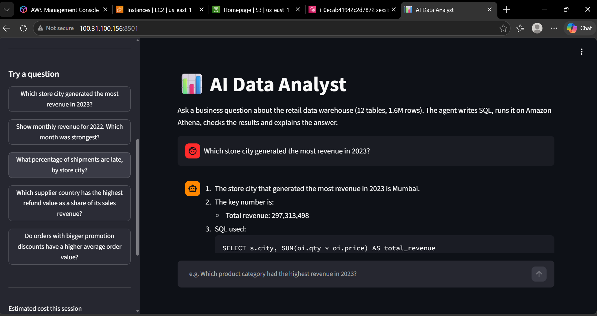
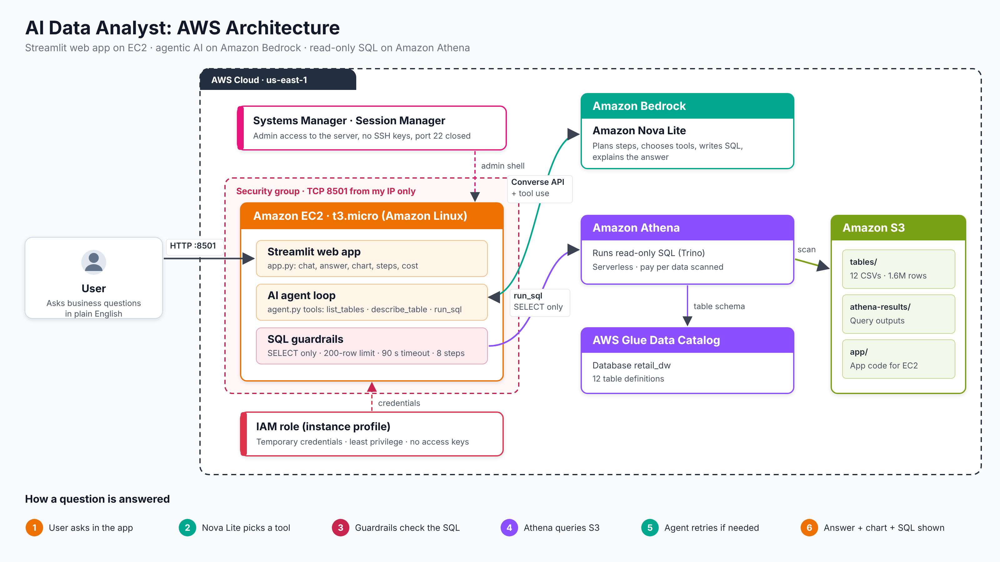

# retail-data-ai-agent-bedrock - Streamlit app on AWS (Bedrock + Athena)

A web app where anyone can ask business questions in plain English about a **12-table retail data warehouse (1.6M+ rows)**. Behind the chat box, an **AI agent on Amazon Bedrock** decides which tables it needs, writes SQL, runs it on **Amazon Athena**, fixes its own failed queries, and answers with the key numbers, a chart and the SQL it used.

The app is hosted on **Amazon EC2** using an IAM role, with no access keys and no SSH.



## What you see in the app

- **Chat box** - type a question or click an example in the sidebar.
- **Answer + chart** - a short answer with the key numbers, and an automatic bar chart of the result.
- **"How the agent worked it out"** - every step the agent took: tables inspected, SQL written, results returned, and any failed query it corrected.
- **Cost per question** - tokens used, data scanned and an estimated cost, plus a running total for the session.

## Architecture




The model is given three **tools** through the Bedrock Converse API and chooses which to call, in what order, until it can answer (maximum 8 steps).

| File | Purpose |
|---|---|
| `app.py` | Streamlit web interface |
| `agent.py` | Agent loop, tools, SQL guardrails, Athena connection |
| `schema.py` | Table definitions and join relationships (single source of truth) |
| `setup_athena.py` | One-time setup: organises the CSVs in S3 and creates the Athena tables |
| `iam-policy.json` | Least-privilege permissions for the app |

## Security and responsible AI

| Area | Control |
|---|---|
| Credentials | EC2 **IAM role** - temporary, auto-rotating credentials; no access keys anywhere |
| Server access | No key pair and **no SSH port**; administration through AWS Systems Manager Session Manager |
| Network | Security group allows **only port 8501, only from my IP** |
| Permissions | **Least privilege**: Athena on one workgroup, read-only access to this dataset, one Bedrock model |
| Data safety | Agent is **read-only** - only single `SELECT`/`WITH` statements; `DROP`, `INSERT`, `DELETE` etc. are blocked in code |
| Cost control | 200-row limit per query, 90-second query timeout, 8-step limit, cost shown per question |
| Trust | Every answer shows the **SQL used**, so a person can check it rather than trust it blindly |
| Audit | Each question and tool call is logged to `agent_trace.jsonl` |

## Data

12 tables: `orders`, `order_items`, `payments`, `shipments`, `returns`, `customers`, `products`, `categories`, `suppliers`, `promotions`, `stores`, `employees`.
Source: *Retail Data Warehouse - 12 Table 1M+ Rows Dataset* (Kaggle). The data is synthetic.

## Deployment (us-east-1)

**1. Data and tables**

- Create an S3 bucket, create a folder `raw/`, and upload the 12 CSV files.

- In AWS CloudShell, upload `schema.py` and `setup_athena.py`, then run `python3 setup_athena.py --bucket <bucket>`.

**2. App files** - upload `app.py`, `agent.py`, `schema.py` and `requirements.txt` to `s3://<bucket>/app/`.

**3. IAM role** - create a role for EC2 with `AmazonSSMManagedInstanceCore` plus an inline policy from `iam-policy.json` (bucket name filled in, with read access to `app/*` added).

**4. EC2 instance** - Amazon Linux 2023, `t3.micro`, no key pair, the IAM role attached, and a security group allowing TCP 8501 from your IP only.

**5. Start the app** - connect with Session Manager and run:

```bash
sudo dnf install -y python3.11 python3.11-pip
mkdir app && cd app && aws s3 cp s3://<bucket>/app/ . --recursive
python3.11 -m pip install --user boto3 streamlit pandas
nohup python3.11 -m streamlit run app.py --server.port 8501 --server.address 0.0.0.0 > streamlit.log 2>&1 &
```

**6. Open** `http://<instance-public-ip>:8501`. Stop the instance when not in use.

## Example questions

- Which store city generated the most revenue in 2023?
- Show monthly revenue for 2022. Which month was strongest?
- What percentage of shipments are late, by store city?
- Which supplier country has the highest refund value as a share of its sales revenue?
- Do orders with bigger promotion discounts have a higher average order value?

## Cost

| Service | Cost |
|---|---|
| EC2 t3.micro + public IP | About 1–2 cents per hour while running (stopped when not in use) |
| Bedrock (Nova Lite) | Well under 1 cent per question |
| Athena | A fraction of a cent per query (dataset is ~40 MB) |
| S3 | Under 1 cent per month |

## Limitations and next steps

- The app uses plain HTTP and has no login; a production version would sit behind an HTTPS load balancer with authentication (e.g. Amazon Cognito).
- Infrastructure was created manually; next step is to define it in **Terraform** and deploy through a **GitHub Actions** pipeline that tests the SQL guardrails first.
- Add a **reviewer agent** that re-checks every number in the answer against the query results.
- CSV storage is simple but slower to scan than Parquet.
- The dataset is synthetic, so patterns are fairly uniform.

The agent also runs from the command line: `python3 agent.py --bucket <bucket> "your question"`.
